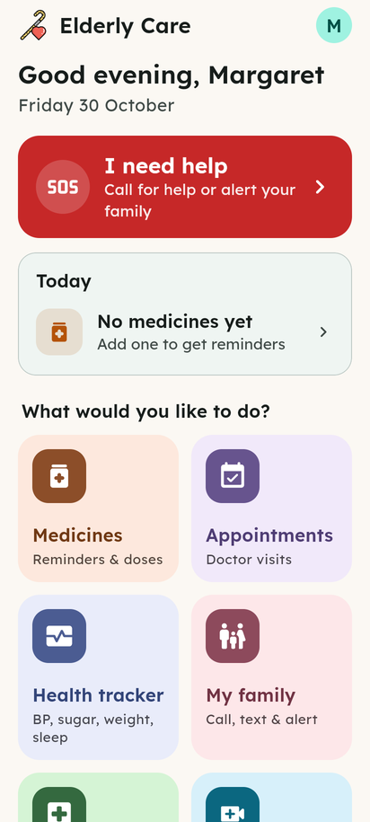
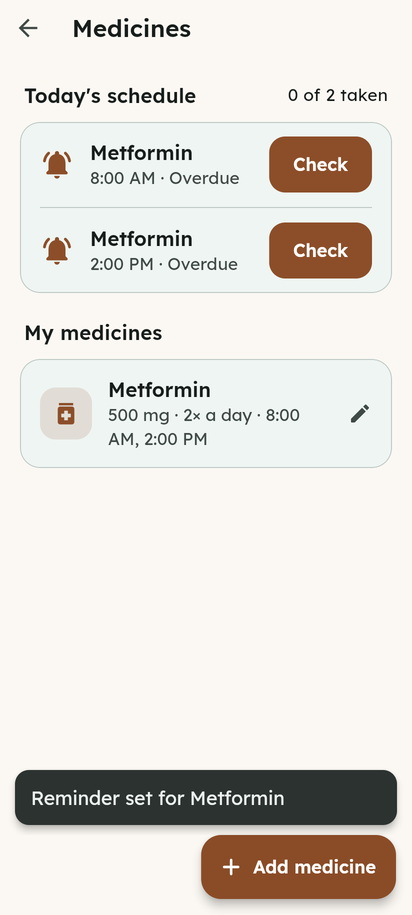
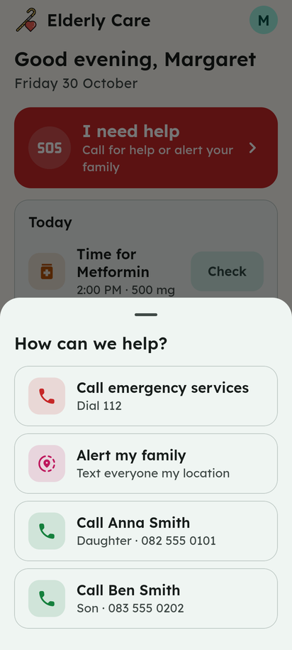
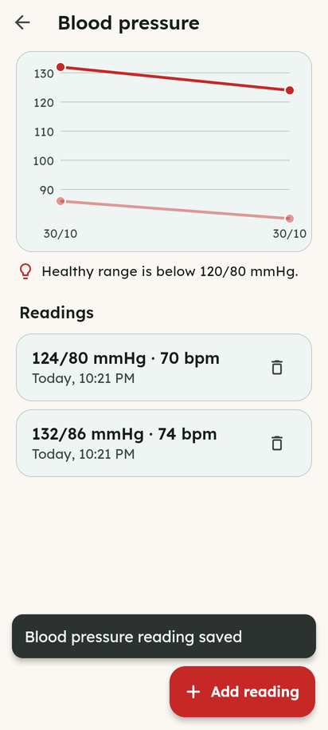
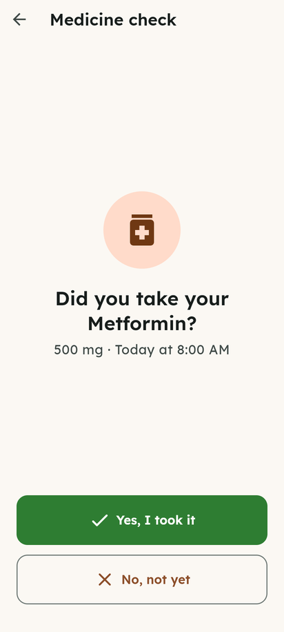
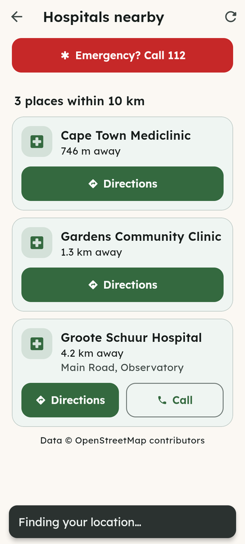
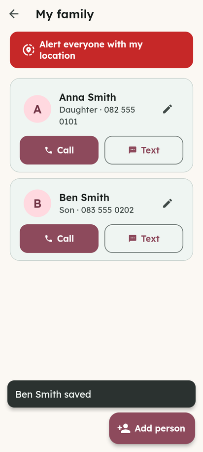
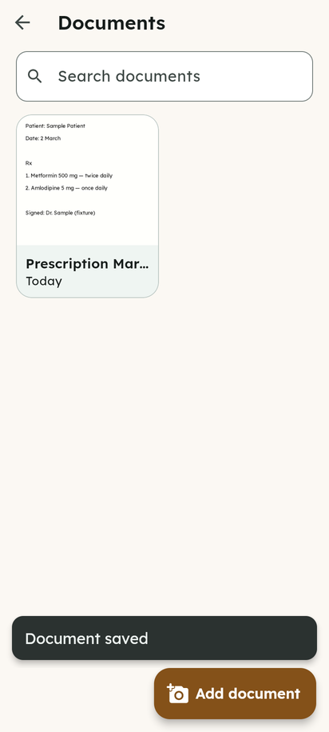
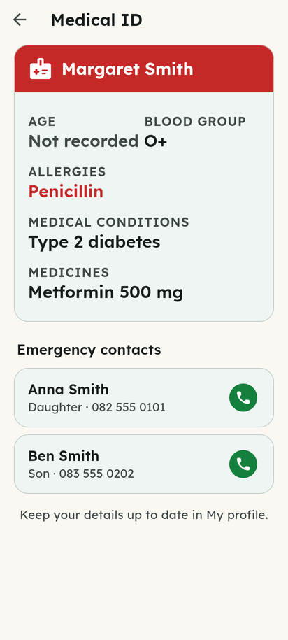
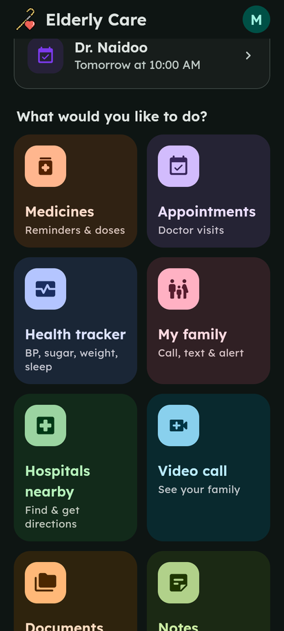

# Elderly Care

The easiest way for an older person to manage medicines, doctor visits, health readings and emergencies, all in one place.

Built with Flutter 3 for **Android, iOS and the web**. Everything is stored on the device. Calls, texts, maps and video calls are handed to the phone's own apps, so no account or server is needed.

<p>




</p>

## Features

| | |
|---|---|
| **Medicine reminders** | Add a medicine, its dose and up to three times a day. The reminder has **Taken**, **In 10 min** and **Not yet** buttons, and a dose left unanswered gets a follow-up an hour later. On Android you can allow exact timing so battery saving doesn't delay reminders. A notification comes when it's due, and the app asks *"Did you take it?"*. If the answer is no, it offers to text the family. It can also count the doses left in the pack and warn when it's time to refill, and it shows how many doses were taken in the last 7 days. |
| **Appointments** | Upcoming and past doctor visits, with a reminder an hour before. |
| **Health tracker** | Blood pressure, blood sugar, weight and sleep, with a chart of recent readings and healthy-range tips. **Share** sends a doctor a 30-day summary as a printable **PDF** or as a plain-text message. |
| **I need help (SOS)** | One big red button: call emergency services (112 by default, changeable), text every family member your current location, show your medical ID, or call a relative directly. |
| **Medical ID** | Allergies, conditions, blood group, medicines and emergency contacts in large type, for paramedics or a new doctor. |
| **My family** | Family and carers with one-tap Call and Text buttons. |
| **Hospitals nearby** | Hospitals and clinics within 10 km from OpenStreetMap (no API key), nearest first, with directions and phone numbers. |
| **Video call** | Opens a free [Jitsi Meet](https://meet.jit.si) call in the user's own private room and texts the family the link. |
| **Documents** | Photos of prescriptions, test results and medical aid cards, searchable by name. |
| **Notes** | Things to remember. Important notes stay at the top. |
| **Profile** | Medical details (blood group, allergies, conditions, usual BP…), the emergency number and an in-app text size setting (Normal / Large / Extra large). |
| **Read aloud** | A speaker button reads out today's summary, the medicine check and the Medical ID. |
| **Backup & restore** | Saves everything to one file you can email to yourself or keep in cloud storage, and restores it on a new phone. |

### Designed for older users
- Large type in [Lexend](https://www.lexend.com/), a font designed for readability. The layout grows with the phone's text-size setting.
- Large touch targets. Every form's main button stays pinned to the bottom of the screen.
- One colour per area of the app, plain-language labels, and a confirmation before anything is deleted.
- Works with screen readers, in dark mode, and on tablets and desktop browsers.

<p>






</p>

## Running it

### The easy way: one script

`run.sh` (macOS/Linux) and `run.ps1` (Windows) do everything: download the project if needed, install Flutter to your home folder if you don't have it, fetch packages and start the app. The only thing you need beforehand is [git](https://git-scm.com) (plus Google Chrome for the default mode).

| Command | What it does |
|---|---|
| `./run.sh` | Run the app in Chrome |
| `./run.sh serve` | Run it as a website at http://localhost:8080, for any browser |
| `./run.sh phone` | Run on a plugged-in phone or an emulator |
| `./run.sh test` | Run the code checks and automated tests |

On Windows use `.\run.ps1`, `.\run.ps1 serve` and so on in PowerShell. If Windows blocks the script, run `Set-ExecutionPolicy -Scope CurrentUser RemoteSigned` once.

You can also download just the script and run it in an empty folder. It clones the repo next to itself.

### By hand

Requires Flutter 3.35 or newer (Dart 3.9+).

```bash
flutter pub get
```

On a phone or emulator:

```bash
flutter run
```

In Chrome:

```bash
flutter run -d chrome
```

To build:

```bash
flutter build apk --release
```

```bash
tool/build_web.sh
```

`tool/build_web.sh` builds the website into `build/web` and adds a Content-Security-Policy to it. Publish it over **https**: browsers only provide the secure storage used for encryption on https sites (and `localhost`).

On the web, reminders appear inside the app rather than as phone notifications, and calls and texts open the computer's default handler.

## Tests

GitHub Actions (`.github/workflows/elderly-app.yml`) runs the formatting check, `flutter analyze` and the tests, then builds the website, the **Android APK** and an unsigned **iOS** app, on every push and pull request that touches the app. Each run's APK can be downloaded from its Artifacts section to install on a phone for testing.

```bash
flutter analyze
```

```bash
flutter test
```

`flutter test` runs unit tests for the scheduling, storage and hospital-search logic, plus widget tests that walk through every feature with fake phone services.

`test_e2e/browser_test.js` drives the release **web build** in headless Chromium (Playwright). It goes from onboarding through every feature, reloads the page to check the data persisted, and saves a screenshot of each step to `test_e2e/output/`. Location is faked and the hospital API is answered from a fixture.

```bash
tool/build_web.sh
```

```bash
node test_e2e/browser_test.js
```

## Security & privacy

- **Encrypted on the device.** Health data (profile, medicines, readings, notes, documents, contacts) is encrypted with AES-256-GCM. The key is random and stays in the platform's secure storage: Android Keystore, iOS Keychain, or Web Crypto in the browser. Data saved by older versions is encrypted automatically on first start.
- **App lock.** An optional 4–8 digit PIN, with fingerprint/face unlock on phones. Only a salted PBKDF2 hash of the PIN is stored. After 5 wrong tries each further try is delayed (30 s, doubling up to 15 min). The app locks when opened and after 2 minutes in the background, and while locked it is hidden from view, screen readers, touch and the keyboard. The Medical ID and the emergency call stay reachable from the lock screen; this can be switched off. A forgotten PIN can only be cleared by erasing all data.
- **Backups.** Created only when the user asks. They can be password-protected (PBKDF2-HMAC-SHA256, 210,000 rounds, then AES-256-GCM). A restore checks the whole file before changing anything, so a wrong or damaged file can't wipe existing data. Files over 60 MB are refused.
- **No automatic cloud copy.** Android cloud backup and device-to-device transfer are turned off for this app.
- **What leaves the device.** The hospital search sends the current location to OpenStreetMap's Overpass API. Video calls use meet.jit.si, in a room named by 16 random characters with no personal details. Calls, texts and shares go through the phone's own apps, and only when the user taps. There are no accounts, servers, analytics or ads, and no secrets or API keys in the app.
- **Web.** The release build has a Content-Security-Policy that only allows the app's own code and the hospital-search API.
- **Logs** never include phone numbers, messages or health data.
- **Dependencies** are kept current by Dependabot (`.github/dependabot.yml`), and every change is checked by CI.

### Signing the Android app for release

Without a key, release builds are signed with the debug key; those must not be published. Create a key once and keep it (and its passwords) safe, outside git:

```bash
keytool -genkey -v -keystore ~/elderly-care-upload.jks -keyalg RSA -keysize 2048 -validity 10000 -alias upload
```

Then create `android/key.properties`, which git ignores:

```properties
storePassword=your-store-password
keyPassword=your-key-password
keyAlias=upload
storeFile=/home/you/elderly-care-upload.jks
```

`flutter build appbundle --release` will then sign with it.

## Legal pages

The app includes, under My profile → **Legal & about**:

| Document | File |
|---|---|
| Terms of Use (Consumer Protection Act, ECT Act s43 disclosures, liability, governing law) | [`assets/legal/terms_of_use.md`](assets/legal/terms_of_use.md) |
| Medical disclaimer (not a medical device, emergency numbers, reminder limits) | [`assets/legal/medical_disclaimer.md`](assets/legal/medical_disclaimer.md) |
| Privacy policy (POPIA, special personal information, cross-border transfers, rights, Information Regulator; GDPR) | [`assets/legal/privacy_policy.md`](assets/legal/privacy_policy.md) |
| Accessibility statement | [`assets/legal/accessibility.md`](assets/legal/accessibility.md) |
| Credits and third-party notices | [`assets/legal/credits.md`](assets/legal/credits.md) |
| Open-source licences | generated by Flutter, plus Lexend (OFL) and OpenStreetMap (ODbL) |

New users must tick "I agree" during setup. Existing users are asked once, and again whenever `LegalInfo.version` in [`lib/legal/legal.dart`](lib/legal/legal.dart) is raised. The accepted version and date are recorded on the device.

### Before publishing

1. Fill in the publisher's details in `LegalInfo.values` (`lib/legal/legal.dart`): name, legal status, registration number, address, email, phone and Information Officer. Until then the documents show "[… to be completed]".
2. Register the Information Officer with the Information Regulator, and prepare a PAIA manual (the privacy policy says it is available on request).
3. Confirm the source and licence of the illustrations and logo carried over from the original project, and credit them (`illustration_credit`), or replace them.
4. Have all documents reviewed by a South African attorney. They were drafted carefully, but they are not legal advice.
5. Whenever the documents change in a way users must accept, update `effectiveDate` and raise `version`.

## Project layout

```
lib/
  main.dart                 app start, theme, first-run gate
  app_scope.dart            gives screens the data store and services
  theme.dart                colours, type scale, per-feature accents
  data/                     models, encrypted on-device store, health summary
  security/                 encryption, app lock, lock screen
  legal/                    legal documents config, Legal & about, agreement
  services/                 calls/SMS/links, location + hospital search, notifications
  screens/<feature>/        one folder per feature
  widgets/common.dart       shared building blocks
```

## Permissions

- **Location**: to find nearby hospitals and, only when you ask, to send your location to your family.
- **Notifications**: for medicine and appointment reminders, which are rescheduled after a reboot.
- **Camera / photos**: to save photos of documents.
- **Internet**: for the hospital search.
- **Fingerprint / face**: optional, to unlock the app.
