<div align="center">


# Elderly Care

**Medicines, appointments, health tracking and emergency help, in one calm app made for older people.**

[](https://github.com/MuneerMiller/WeThinkCode-Projects/actions/workflows/elderly-app.yml)


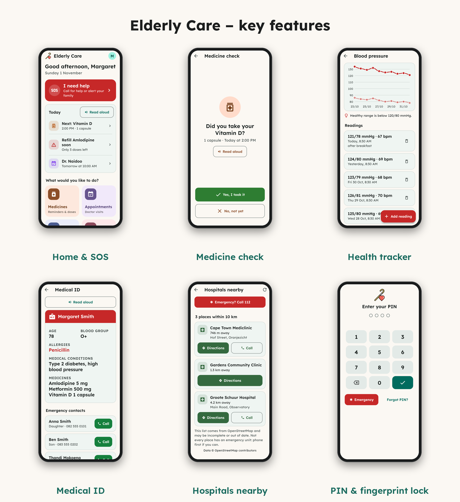

</div>

## Why

Older people often juggle several medicines, doctor visits and readings, and want to reach family quickly when something is wrong. Elderly Care puts all of that behind large, clear buttons. It keeps everything private on the phone: no account, no server, no tracking.

## Features

| | |
|---|---|
| 💊 **Medicine reminders** | Up to three doses a day. Notifications have **Taken**, **In 10 min** and **Not yet** buttons, and an unanswered dose gets a follow-up an hour later. A missed dose can be texted to family. Optional pack count with refill warnings, and a 7-day record. |
| 📅 **Appointments** | Upcoming and past doctor visits, with a reminder an hour before. |
| ❤️ **Health tracker** | Blood pressure, blood sugar, weight and sleep, with charts and healthy-range tips. **Share** sends the doctor a 30-day summary as a printable **PDF** or a message. |
| 🆘 **I need help** | One big red button: call emergency services, text every family member your location, show your Medical ID or call a relative. |
| 🪪 **Medical ID** | Allergies, conditions, blood group, medicines and emergency contacts in large type for paramedics. Reachable even when the app is locked. |
| 👨‍👩‍👧 **My family** | One-tap Call and Text for family and carers. |
| 🏥 **Hospitals nearby** | Hospitals and clinics within 10 km from OpenStreetMap, nearest first, with directions and phone numbers. |
| 📹 **Video call** | Starts a free, private Jitsi Meet call and texts the family the link. |
| 📄 **Documents & notes** | Photos of prescriptions and test results, searchable by name, plus notes with important ones on top. |
| 🔊 **Read aloud** | Reads today's summary, the medicine check and the Medical ID out loud. |
| 🔒 **Privacy & security** | Encrypted storage, PIN and fingerprint/face lock, password-protected backups. |

### Designed for older users

- **Easy to read:** the [Lexend](https://www.lexend.com/) typeface at large sizes, plus an in-app Normal / Large / Extra large setting on top of the phone's own text size.
- **Easy to tap:** big buttons, and every form's main button pinned to the bottom of the screen.
- **Easy to understand:** plain language, one colour per area of the app, and confirmation before anything is deleted.
- **Works everywhere:** with screen readers and the keyboard, in dark mode, and on tablets and desktop browsers.

## Screenshots

<table>
  <tr>
    <td align="center" width="25%">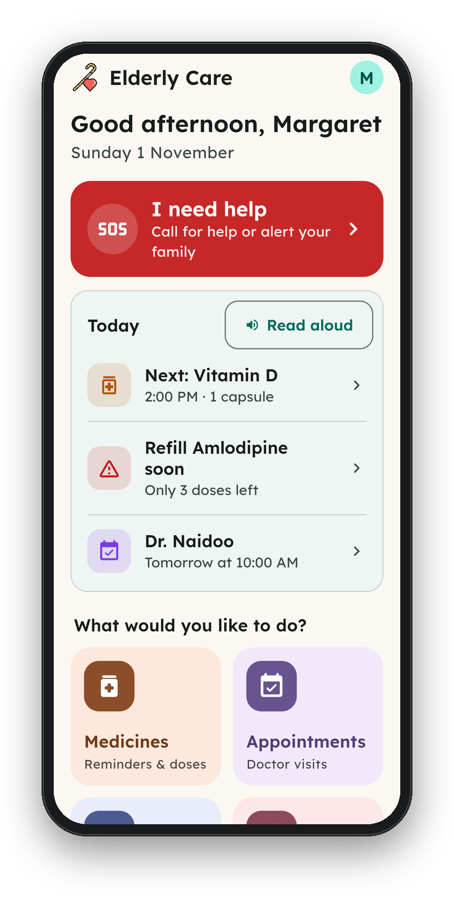<br><sub><b>Home</b><br>Today at a glance and the SOS button</sub></td>
    <td align="center" width="25%">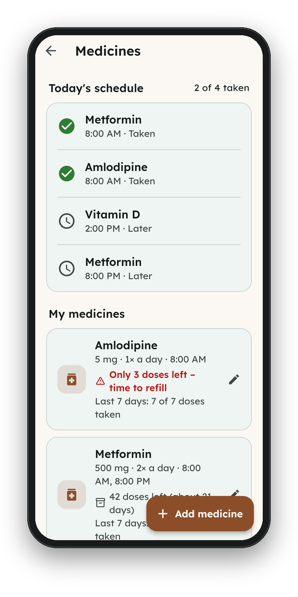<br><sub><b>Medicines</b><br>Today's schedule and refill warnings</sub></td>
    <td align="center" width="25%">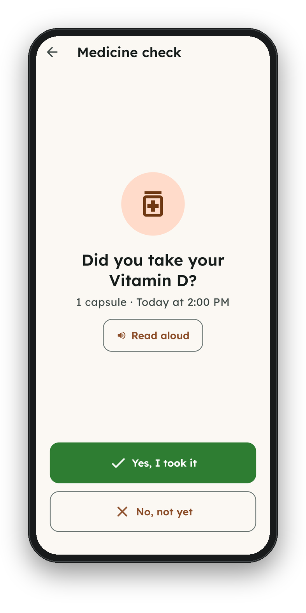<br><sub><b>Medicine check</b><br>One tap to record a dose</sub></td>
    <td align="center" width="25%">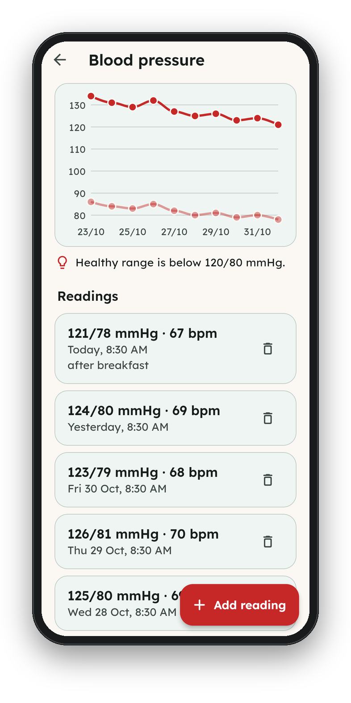<br><sub><b>Health tracker</b><br>Readings with a chart</sub></td>
  </tr>
  <tr>
    <td align="center">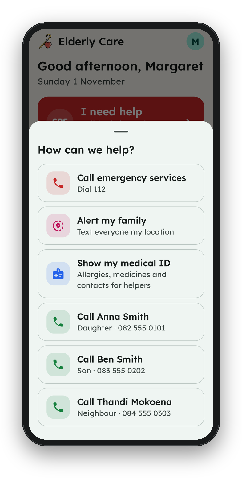<br><sub><b>I need help</b><br>Call, alert family, Medical ID</sub></td>
    <td align="center">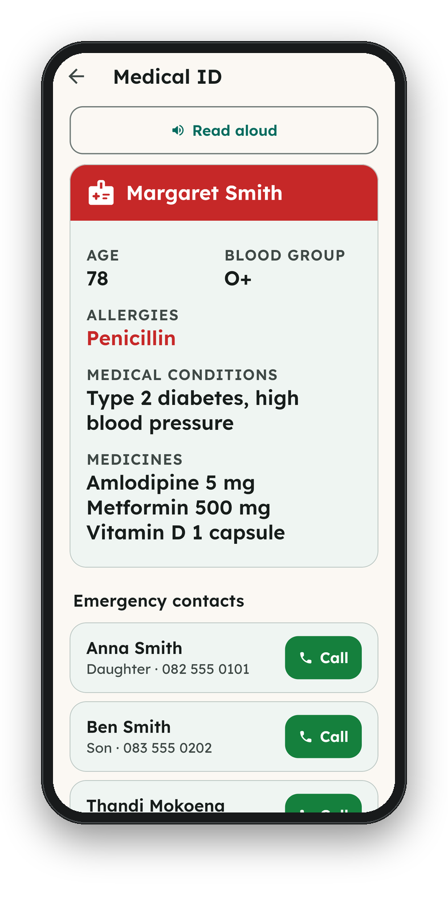<br><sub><b>Medical ID</b><br>For paramedics and doctors</sub></td>
    <td align="center">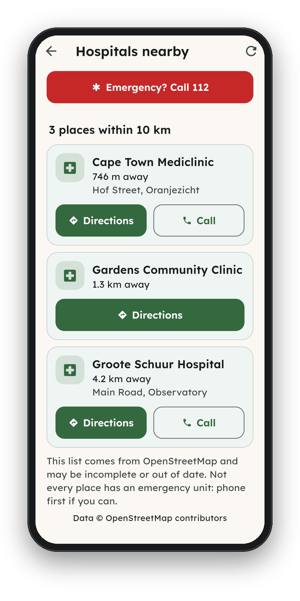<br><sub><b>Hospitals nearby</b><br>Directions and phone numbers</sub></td>
    <td align="center">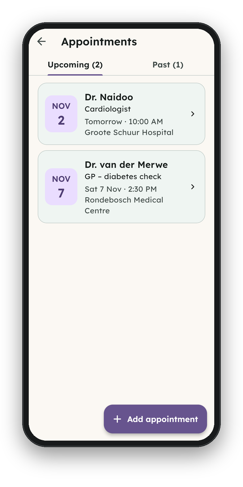<br><sub><b>Appointments</b><br>With reminders an hour before</sub></td>
  </tr>
  <tr>
    <td align="center">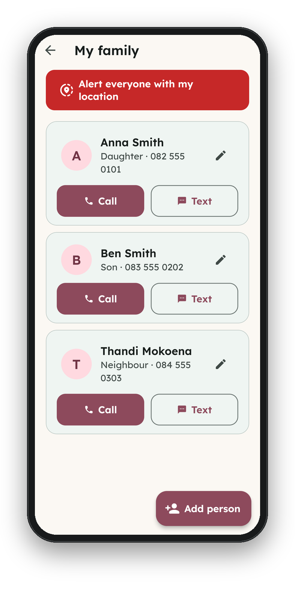<br><sub><b>My family</b><br>Call or text in one tap</sub></td>
    <td align="center">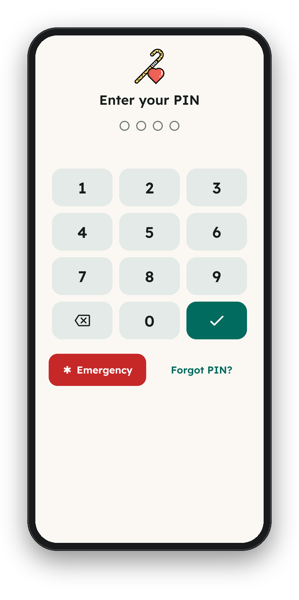<br><sub><b>App lock</b><br>PIN or fingerprint/face</sub></td>
    <td align="center">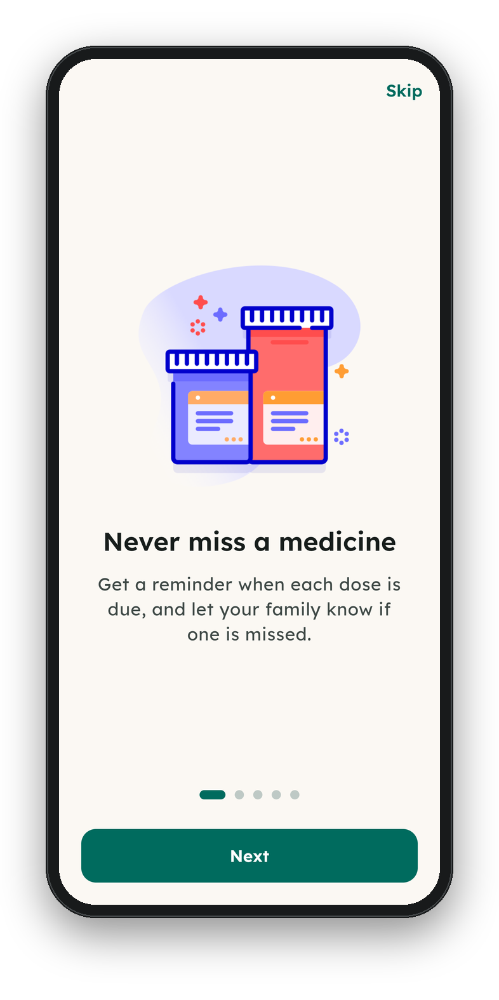<br><sub><b>Welcome</b><br>A short, friendly introduction</sub></td>
    <td align="center">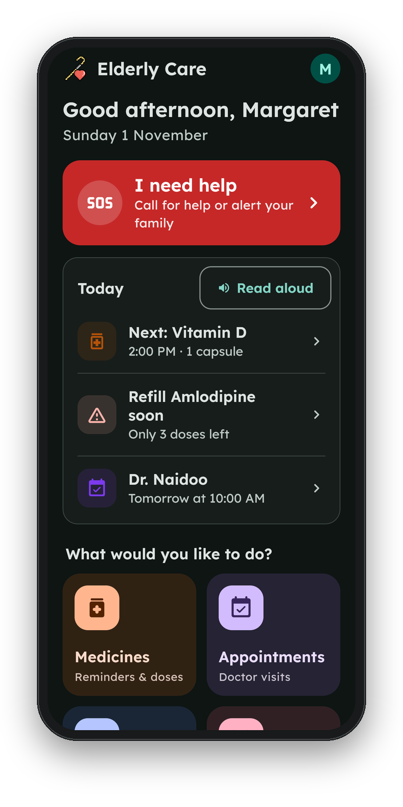<br><sub><b>Dark mode</b><br>Follows the phone's setting</sub></td>
  </tr>
</table>

<p align="center">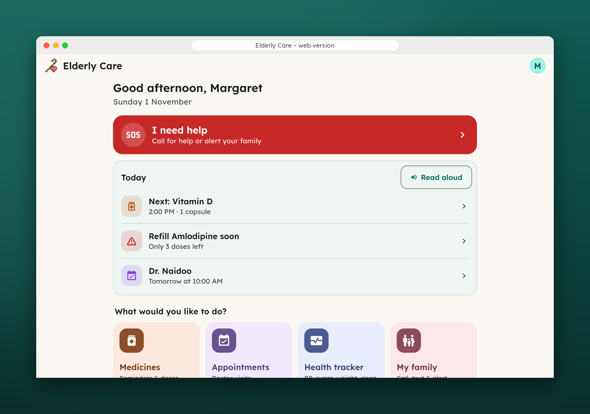<br><sub>The same app on the web.</sub></p>

Full-resolution screenshots of every screen are in [`docs/screenshots/screens`](docs/screenshots/screens). All names and health details shown are made up.

## Getting started

### The easy way: one script

[`run.sh`](run.sh) (macOS/Linux) and [`run.ps1`](run.ps1) (Windows) download the project if needed, install Flutter if you don't have it, and start the app. You only need [git](https://git-scm.com) (and Google Chrome for the default mode).

| Command | What it does |
|---|---|
| `./run.sh` | Run the app in Chrome |
| `./run.sh serve` | Run it as a website at http://localhost:8080, for any browser |
| `./run.sh phone` | Run on a plugged-in phone or an emulator |
| `./run.sh test` | Run the code checks and automated tests |

On Windows use `.\run.ps1`, `.\run.ps1 serve` and so on. If PowerShell blocks scripts, run `Set-ExecutionPolicy -Scope CurrentUser RemoteSigned` once.

**Try it on an Android phone without building:** open the latest [CI run](https://github.com/MuneerMiller/WeThinkCode-Projects/actions/workflows/elderly-app.yml) and download **elderly-care-android** under *Artifacts*.

<details>
<summary><b>By hand with Flutter</b></summary>

Requires Flutter 3.35 or newer (Dart 3.9+).

```bash
flutter pub get
```

```bash
flutter run
```

```bash
flutter run -d chrome
```

Release builds:

```bash
flutter build apk --release
```

```bash
tool/build_web.sh
```

`tool/build_web.sh` builds the website into `build/web` with a Content-Security-Policy. Publish it over **https**, because browsers only provide the secure storage used for encryption on https sites (and `localhost`). On the web, reminders appear inside the app rather than as phone notifications.

</details>

## Quality

| | |
|---|---|
| **Unit & widget tests** | 79 tests: scheduling, reminders, encryption, backups, the app lock, legal acceptance and every feature end to end with fake phone services, including at large text sizes. Run `flutter test`. |
| **Browser tests** | [`test_e2e/browser_test.js`](test_e2e/browser_test.js) drives the release web build in Chromium through every feature, checks the PDF's contents and that nothing readable is left in browser storage, and screenshots each step. |
| **Continuous integration** | Every change runs formatting, `flutter analyze` and the tests, then builds the website, the Android APK and the iOS app. |
| **Dependencies** | Kept up to date by Dependabot. |

## Security & privacy

- **Encrypted on the device:** health data is encrypted with AES-256-GCM, using a random key kept in Android Keystore, iOS Keychain or Web Crypto.
- **App lock:** an optional PIN, stored only as a salted PBKDF2 hash, with fingerprint/face unlock. Delays grow after 5 wrong tries, and the app locks again after 2 minutes away. While locked it is hidden from view, screen readers, touch and the keyboard.
- **Safe backups:** optional password protection, and a restore checks the whole file before changing anything.
- **Nothing leaves without you:** no accounts, servers, analytics, ads or API keys. Only the hospital search (your location, to OpenStreetMap) and video calls (Jitsi Meet) use outside services, and only when you use them.
- **Hardened builds:** no automatic Android cloud backup, private notifications, no personal data in logs, and a Content-Security-Policy on the web.

<details>
<summary><b>Signing the Android app for release</b></summary>

Without a key, release builds use the debug key and must not be published. Create a key once and keep it, and its passwords, outside git:

```bash
keytool -genkey -v -keystore ~/elderly-care-upload.jks -keyalg RSA -keysize 2048 -validity 10000 -alias upload
```

Then create `android/key.properties` (git ignores it):

```properties
storePassword=your-store-password
keyPassword=your-key-password
keyAlias=upload
storeFile=/home/you/elderly-care-upload.jks
```

`flutter build appbundle --release` will then sign with it.

</details>

## Legal

Under **My profile → Legal & about**, the app includes:

- [Terms of Use](assets/legal/terms_of_use.md)
- [Medical disclaimer](assets/legal/medical_disclaimer.md)
- [Privacy policy](assets/legal/privacy_policy.md), written for POPIA and the GDPR
- [Accessibility statement](assets/legal/accessibility.md)
- [Credits](assets/legal/credits.md)
- the open-source licences

New users accept them during setup. Existing users are asked again whenever `LegalInfo.version` in [`lib/legal/legal.dart`](lib/legal/legal.dart) changes.

<details>
<summary><b>Before publishing</b></summary>

1. Fill in the publisher's details in `LegalInfo.values` (`lib/legal/legal.dart`). Until then the documents show "[… to be completed]".
2. Register an Information Officer with the Information Regulator, and prepare a PAIA manual.
3. Confirm the source and licence of the illustrations and logo carried over from the original project, and credit them, or replace them.
4. Have the documents reviewed by a South African attorney. They were drafted carefully, but they are not legal advice.
5. When the documents change, update `effectiveDate` and raise `version`.

</details>

## Under the hood

<details>
<summary><b>Project layout</b></summary>

```
lib/
  main.dart                 app start, theme, first-run and legal gates, app lock overlay
  app_scope.dart            gives screens the data store and services
  theme.dart                colours, type scale, per-feature accents
  data/                     models, encrypted on-device store, text and PDF summaries
  security/                 encryption, app lock, lock screen
  legal/                    legal documents, Legal & about, agreement
  services/                 notifications and reminder plan, calls/SMS, location and
                            hospital search, sharing, read aloud
  screens/<feature>/        one folder per feature
  widgets/                  shared building blocks
test/                       unit and widget tests
test_e2e/                   browser tests (Playwright)
tool/build_web.sh           release web build with a Content-Security-Policy
```

</details>

<details>
<summary><b>Permissions</b></summary>

- **Location:** to find nearby hospitals and, only when you ask, to send your location to your family.
- **Notifications and exact alarms:** for medicine and appointment reminders, which are restored after a reboot.
- **Camera / photos:** to save photos of documents.
- **Fingerprint / face:** optional, to unlock the app.
- **Internet:** for the hospital search.

</details>

<details>
<summary><b>Built with</b></summary>

Flutter and Dart, with packages including `flutter_local_notifications`, `cryptography`, `flutter_secure_storage`, `local_auth`, `fl_chart`, `pdf`, `share_plus`, `geolocator`, `url_launcher` and `flutter_tts`. Map data © OpenStreetMap contributors.

</details>
